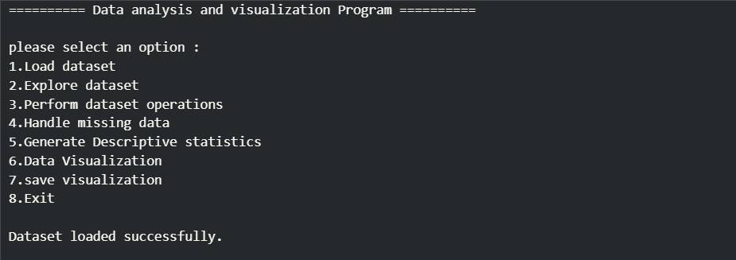
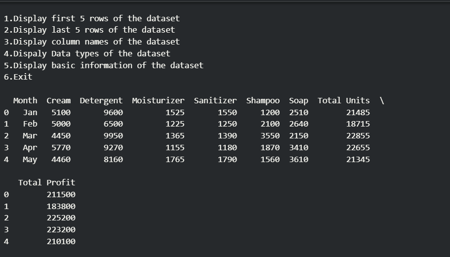
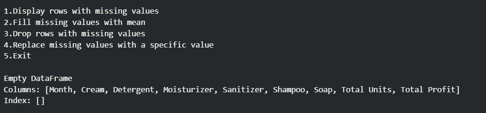
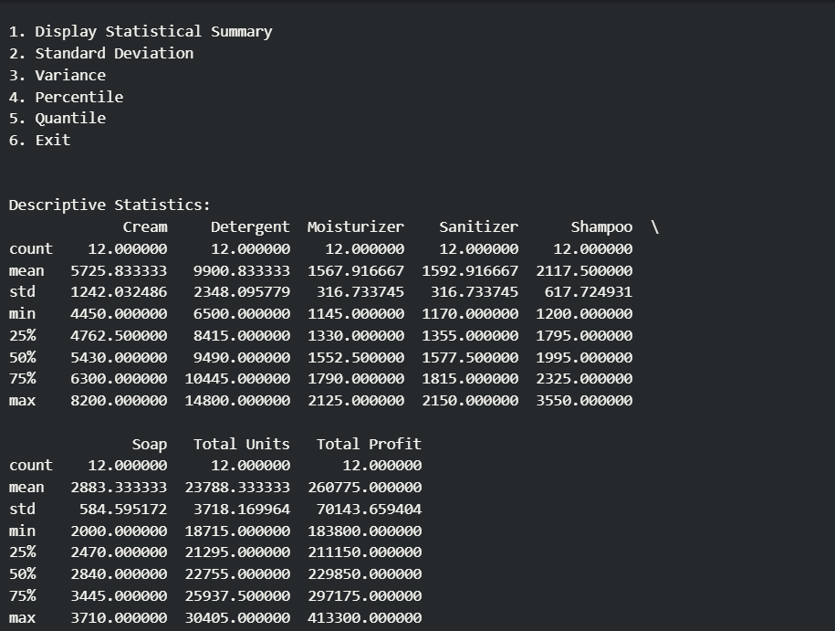
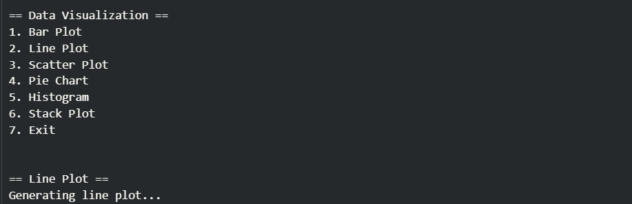
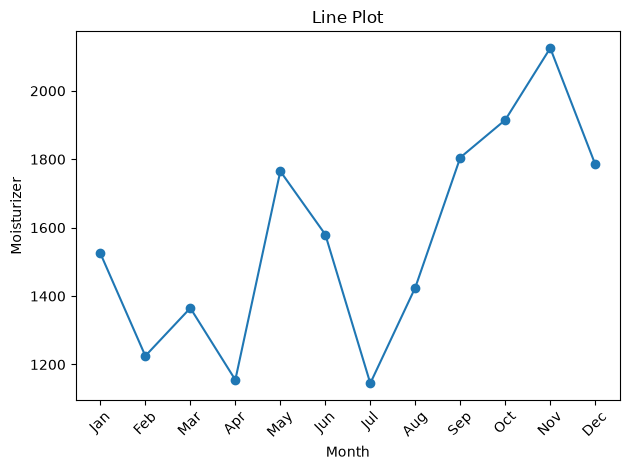
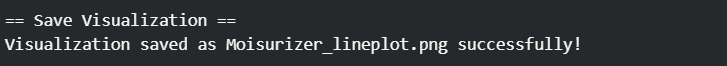

# Data Analysis and Visualization Program

A menu-driven Python project for exploring CSV datasets, performing data operations, handling missing values, calculating descriptive statistics, and creating visualizations.

## 📌 Project Description

**Data Analysis and Visualization Program** uses Pandas, NumPy, Matplotlib, and Seaborn to provide an interactive workflow for analyzing data from a CSV file.

The notebook loads `Product Sales Data.csv` by default and also allows the user to load another CSV file through the menu. Users can explore dataset contents, perform data operations, handle missing values, calculate statistics, and generate different charts.

## 🛠️ Technologies Used

- Python
- Pandas
- NumPy
- Matplotlib
- Seaborn
- Jupyter Notebook
- CSV files
- Functions, loops, conditional statements, and user input

## ✨ Main Features

1. Load a dataset
2. Explore the dataset
3. Perform dataset operations
4. Handle missing data
5. Generate descriptive statistics
6. Create data visualizations
7. Save visualizations
8. Exit the program

---

# 📚 Features and Operations

## 1. Load Dataset

- Load `Product Sales Data.csv` by default.
- Enter a different CSV filename when prompted.
- Display a success message when the dataset loads.
- Handle a missing file with an error message.

### 📸 Output Screenshot



*Screenshot 1: Loading the dataset. Add your own screenshot at this path.*

## 2. Explore Dataset

The Explore Dataset menu provides options to:

- Display the first 5 rows using `head()`
- Display the last 5 rows using `tail()`
- Display column names
- Display column data types
- Display basic dataset information using `info()`

### 📸 Output Screenshot



*Screenshot 2: Exploring the dataset.*

## 3. Perform Dataset Operations

The dataset operations menu includes:

### NumPy Arrays, Indexing and Slicing
- Select a numeric column and convert it to a NumPy array.
- Access elements using an index.
- Display a slice of an array.

### Mathematical Operations
- Select two columns.
- Perform addition, subtraction, multiplication, and division using NumPy arrays.

### Combine DataFrames
- Concatenate DataFrames with `pd.concat()`.
- Merge DataFrames with `pd.merge()`.
- Join DataFrames using `join()`.

The notebook's examples use columns such as `Month`, `Cream`, and `Detergent`.

### Split, Search, Sort and Filter
- Select rows matching a month.
- Search for month values.
- Sort a selected column in ascending or descending order.
- Filter rows based on a selected month.

### Aggregating Functions
Choose a numeric column and calculate:
- Sum
- Mean
- Count

### 📸 Output Screenshot

.png)
.png)

*Screenshot 3: Dataset operations.*

## 4. Handle Missing Data

The missing-data menu provides options to:

- Display rows containing missing values
- Fill missing numeric values using column means
- Drop rows containing missing values
- Replace missing values with a user-specified value

### 📸 Output Screenshot



*Screenshot 4: Handling missing data.*

## 5. Generate Descriptive Statistics

The statistics menu includes:

- Descriptive summary using `describe()`
- Standard deviation
- Variance
- Percentile
- Quantile

The program accepts a percentile from **0 to 100** or a quantile from **0 to 1**.

### 📸 Output Screenshot



*Screenshot 5: Statistical analysis.*

## 6. Data Visualization

The visualization menu supports six chart types:

| Chart | Purpose |
|---|---|
| Bar Plot | Compare values across categories |
| Line Plot | Show trends or changes across values |
| Scatter Plot | Explore the relationship between two numeric columns |
| Pie Chart | Show the distribution of values in a column |
| Histogram | View the distribution of numeric values |
| Stack Plot | Display cumulative values for multiple numeric columns |

For charts using X and Y axes, enter column names that exist in the loaded dataset. Some chart types require numeric columns.

### 📸 Output Screenshots

*Screenshot 6: Line plot.*





## 7. Save Visualization

The program asks for a filename and saves the current Matplotlib figure as a PNG image. If the filename does not already end in `.png`, the program adds the extension.

Example:

```text
Moisurizer_lineplot.png
```

### 📸 Output Screenshot



---

## 📋 Main Menu

When the program starts, it displays this menu:

```text
1. Load dataset
2. Explore dataset
3. Perform dataset operations
4. Handle missing data
5. Generate Descriptive statistics
6. Data Visualization
7. Save visualization
8. Exit
```

Enter the menu number to choose an operation. Some options open a submenu with additional operations.

## 📁 Project Structure

Recommended repository structure:

```text
Data-Analysis-and-Visualization/
│
├── Visualizer.ipynb
├── Product Sales Data.csv
└── README.md
 
- `Visualizer.ipynb` — contains the interactive program.
- `Product Sales Data.csv` — default dataset used by the notebook.
- `README.md` — project documentation.

If your notebook or dataset has a different filename, update the names above to match your repository.

## ⚙️ Installation

Install the required libraries:

```bash
pip install pandas numpy matplotlib seaborn jupyter
```

## ▶️ How to Run

1. Download or clone the repository.
2. Keep the notebook and CSV dataset in the same folder, or provide the correct CSV path when prompted.
3. Open the project folder in VS Code or Jupyter Notebook.
4. Run the notebook cells in order.
5. Use the displayed menu to choose an operation.
6. Enter column names that exist in the loaded dataset.
7. Choose **Exit** when finished.

To launch Jupyter Notebook from a terminal:

```bash
jupyter notebook
```

## 📸 How to Add Output Screenshots

1. Run the notebook and choose an operation from the menu.
2. Take a screenshot of the output or generated chart.
3. Create a folder named `screenshots` beside the README.
4. Save the image using the filename shown in the relevant screenshot section.
5. Add the `screenshots` folder to your GitHub repository.

**Important:** The screenshot links above are placeholders until you add images with matching filenames. GitHub will display the images once the files are committed to the repository.

For a strong project presentation, include screenshots of the main menu, dataset exploration, statistics, and several chart types.

## 🎯 Learning Outcomes

This project provides practice with:

- Loading and exploring CSV datasets with Pandas
- Inspecting DataFrame rows, columns, and data types
- Converting DataFrame columns into NumPy arrays
- Indexing and slicing arrays
- Performing element-wise mathematical operations
- Concatenating, merging, and joining DataFrames
- Searching, sorting, and filtering data
- Handling missing values
- Calculating descriptive and statistical measures
- Creating charts with Matplotlib and Seaborn
- Saving plots as image files
- Building menu-driven Python programs with loops and conditions

## 👩‍💻 Author

**Yatri**  
Computer Engineering Student | Data Science Student

---

## ✅ Conclusion

The **Data Analysis and Visualization Program** is a practical project for learning how to explore datasets, perform data operations, calculate statistics, and visualize information using Python libraries. Its menu-driven design brings these tasks together in one interactive program.
